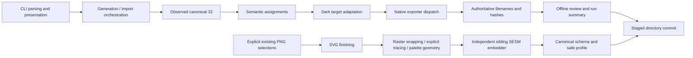

# Architecture and stabilization

Current source boundary: 2026-10-25. Package 0.1.0 remains a local pilot. Exporter expansion is paused while existing outputs are refined. SVG finishing is a separate asset utility, not a sixteenth theme target.

## Data flow

## Ownership and interfaces

| Responsibility | Owner | Stable boundary |
| --- | --- | --- |
| Arguments, streams and exit codes | `apt_theme.cli` | `main`, compatibility `build` and `write_json` |
| Generation/import orchestration | `apt_theme.pipeline` | Input preservation, configuration, run assembly |
| Color selection and assignment | `extraction`, `colors`, `semantics` | Canonical values remain independent of target tokens |
| Target adaptation | `apt_theme.targets` | Fifteen target IDs, budgets and `adapt`; compatibility exporter helpers |
| Native output dispatch | `apt_theme.exporters` | Existing specialized modules, native packages and target artifacts |
| Identity and artifact lookup | `identity`, `output_names` | Five generation prefixes, authoritative manifests, historical fallback |
| Output commit/rollback | `apt_theme.transactions` | Sibling staging; failed replacement restores the prior run |
| Collection exploration | `apt_theme.atlas` | Read-only selected run snapshots; no theme regeneration |
| Asset finishing | `apt_theme.finishing`, `svg_converter` | Explicit selections, fresh destination, no generation side effects |
| SVG metadata authoring | Independent `SESM-Metadata-Embedder` project | Explicit root/configuration/write; artwork-preserving insertion |

The direct SVG script remains a compatibility entry point. Installed wheels include the converter implementation; they do not need repository scripts. The SESM project and canonical standard remain external dependencies of finishing, selected through explicit CLI paths when not available at their local defaults.

Generation and Atlas retain their own ownership/overwrite checks. They share only the staging/commit mechanism. Finishing always requires a fresh destination. Manifest validation is shared between Atlas, ordinary artifact lookup and finishing; Atlas retains its additional source/lineage checks.

## Repository layout

Keep the existing package and directories. `assets/` contains source artwork/catalogs; `output/` contains local generated runs; `pilot/` contains dated specimens. `tests/` owns regression checks. `tools/` contains verification helpers plus clearly identified historical migration workflows. `migration/archives/`, `legacy-tools/`, historical presentations and the old Theming Index remain preserved.

Current source/contracts take precedence over dated counts and filename examples in historical records. Start with [commands](COMMAND-CONTRACT.md), [output naming](OUTPUT-NAMING.md), [SVG finishing](SVG-FINISHING.md) and [testing](TESTING-REFERENCE.md). The [audit](STABILIZATION-AUDIT.md) records the reasons for this structure and remaining limits.

## Change and verification discipline

Refactor in bounded batches. Compare complete fresh generation/import artifact hashes before and after structural work. Native package bytes, canonical values and output discovery remain compatibility gates. Browser previews, native application import, installation and publication are distinct evidence. No current check authorizes modifying public copies.
